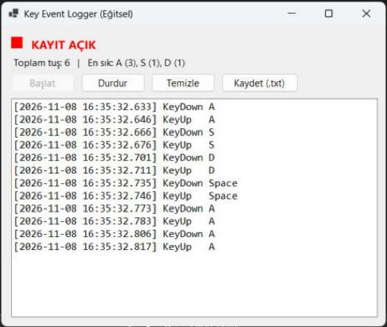
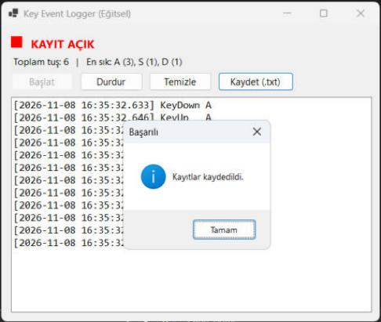

# YMH219-KeyEventLogger

Windows Forms ile geliştirilmiş **eğitsel** bir klavye olay kaydedicisi. Nesne Tabanlı Programlama (YMH 219) dersi ek uygulama ödevidir.

Uygulama yalnızca **kendi penceresi aktifken** basılan tuşları gösterir. Global hook, gizli çalışma, ağ üzerinden gönderim yoktur; gerçek bir keylogger değildir.

## Kullanılan Teknolojiler
- C# / .NET 10 (Windows Forms)
- .NET 10 SDK (Visual Studio'da .NET 10 destekleyen güncel bir sürüm)
- Harici NuGet paketi kullanılmamıştır

## Kurulum ve Çalıştırma
1. Depoyu klonlayın: `git clone https://github.com/cumalibilgic/YMH219-KeyEventLogger.git`
2. Komut satırında `dotnet run --project YMH219-KeyEventLogger.csproj` komutunu çalıştırın.
3. Alternatif olarak `YMH219-KeyEventLogger.csproj` dosyasını Visual Studio'da açıp `F5` ile çalıştırın.

## Özellikler
- KeyDown / KeyUp olaylarını tuş adı ve tarih-saat ile listeleme
- Başlat / Durdur ile kayıt kontrolü, kayıt durumu göstergesi (kırmızı = kayıt açık)
- Temizle butonu
- Kayıtları `.txt` dosyasına kaydetme (StreamWriter)
- Toplam tuş sayısı ve en sık kullanılan 3 tuş istatistiği

## Proje Yapısı
- `KeyRecord.cs` : tek bir olay kaydı (sınıf)
- `LogFileWriter.cs` : dosyaya yazma işlemi
- `MainForm.cs` : arayüz ve olay yönetimi
- `Program.cs` : giriş noktası

## Ekran Görüntüleri
Kayıt açıkken tuş olayları ve kaydetme sonrası bilgi mesajı:

## Bilinen Sınırlamalar
- Yalnızca uygulama penceresi odaktayken tuşlar yakalanır.
- Türkçe karakterler tuş kodu adıyla gösterilir (ör. `Oem1`).

## Öğrenci
Cumali Bilgiç — Öğrenci No: 250541008
